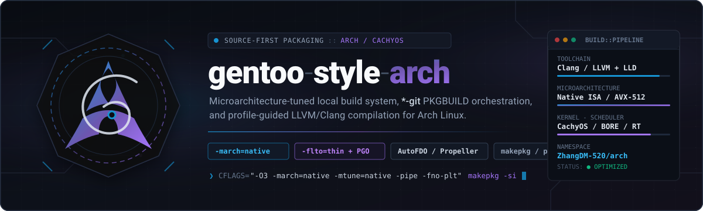

<p align="center"></p>

# Gentoo_Style_Arch — the engine

`gsa`, the build engine for a curated Arch Linux package set. The set itself —
`PKGBUILD` recipes and the declarative topology that orders them — lives in its
own repository,
[ZhangDM-520/gsa-recipe](https://github.com/ZhangDM-520/gsa-recipe).

The engine exists so a large, dependency-coupled desktop and toolchain stack
rebuilds from recipes with one command: it resolves the build order from the
recipe repository's topology, builds and installs each package before its
consumers compile, and keeps the whole run accountable — plan, outcome, and
continuation — as one run record. Nothing here is tuned to a machine; the
recipes are. This repository is ordinary Rust source, and a clean checkout
builds with `cargo`.

## What is here

- **`crates/`** — the workspace (thirteen crates, one binary): the model and the
  `format: 2` run record, the strict topology and recipe loaders, the consumer
  graph and coupled batches, the lane supervisor, makepkg orchestration, the
  install decision seam, fetch-ahead, the side-car state database, the
  report-only QA lints, the `-M` surface and the CLI grammar.
- **`tests/`** — the fixture battery. Fixtures synthesize `$TMPDIR`
  workspaces and PATH stubs; the real-recipe-tree checks read the recipe
  repository through `GSA_RECIPE_CHECKOUT` and skip loudly when it is absent.
  `tests/assets/` is the frozen fish-era engine kept as differential oracle
  material — reference, never a command.
- **`tools/`** — the ABI pre-transaction checker and its hook, installed by the
  `gsa-pm` package.
- **`docs/`** — `gsa-contract.md` (the authoritative interface),
  `build-guide.md`, `architecture.md`, `portability.md`, the fixture
  migration inventory, the decision records (`adr/`), and `JOURNAL.md` (one
  dense line per action). `docs/plans/` holds the four archive-class design
  records that code comments cite by section — provenance, never
  specification (see `docs/plans/README.md`).

What is deliberately absent: recipes, upstream source trees, package archives,
signatures and build output. The engine consumes a recipe workspace and never
carries one.

## Quickstart

Development, from an Arch-based system:

```sh
cargo build --release      # ./target/release/gsa
cargo test --workspace     # the crate suite
bash tests/run-all.sh      # the fixture battery
```

`tests/run-all.sh` defaults to the **installed** `/usr/bin/gsa` (the contract's
smoke-the-shipped-binary rule) and prints the binary and its owning package;
`GSA_TEST_GSA_BIN=$PWD/target/release/gsa` is the explicit pre-install
override and is reported as a deviation.

Point the engine at a recipe checkout and run it:

```sh
git clone https://github.com/ZhangDM-520/gsa-recipe ~/Projects/gsa-recipe
printf 'project = %s\n' ~/Projects/gsa-recipe > ~/.config/gsa/gsa.conf
gsa --help                 # the authoritative command roster
gsa -Sl @git               # the set, in build order
gsa -S --dry-run @git      # plan and decision rows, no mutation
```

Installing it as `/usr/bin/gsa` uses the `gsa-pm` recipe in the recipe
repository — a bootstrap recipe, so a broken engine is always recoverable with
plain `makepkg`:

```sh
cd ~/Projects/gsa-recipe
GIT_CONFIG_COUNT=0 makepkg -f --dir packages/core/gsa-pm
sudo pacman -U packages/core/gsa-pm/gsa-pm-*.pkg.tar.zst
```

## The two repositories

| Repository | Holds | Memory |
| --- | --- | --- |
| `gentoo-style-arch` (this one) | `crates/`, `tests/`, `tools/`, engine docs | `AGENTS.md`, `docs/JOURNAL.md` |
| `gsa-recipe` | `packages/`, `config/`, `lib/`, recipe fixtures and docs | its own `AGENTS.md`, `docs/JOURNAL.md` |

The boundary is the canonical recipe store: a build-user working copy fetched
from `recipe_url` (default: the recipe repository) and refreshed in place by
`gsa -Sy`. A dev checkout is read-only input, selected by `gsa.conf`'s
`project` key or by `GSA_RECIPE_CHECKOUT`; editing it never changes what a
build sees until the store syncs.

## Where to go next

| Document | What it answers |
| --- | --- |
| `docs/gsa-contract.md` | **Authoritative.** Grammar, selection, hidden seams, decision rows, exit codes, state layout, concurrency |
| `docs/build-guide.md` | Operations: families, inspect/dry-run/build, installation semantics, environment surface, troubleshooting |
| `docs/architecture.md` | The crate split and the scheduler's invariants |
| `docs/portability.md` | Intensity profiles and their formulas, CPU/ISA policy |
| `docs/gsa-fixture-migration.md` | Per-fixture inventory: what each fixture pins, KEEP vs REWRITE |
| `docs/adr/` | The decisions that fought back: the run record, the prefetch advisory |
| `AGENTS.md` | This repository's memory: rules, pitfalls, queue, shell-boundary hazards |
| `CONTRIBUTING.md` | Change hygiene, the validation standard, the commit policy |
| `SECURITY.md` | Trust model and safe-operation rules |

## Licensing

`LICENSE` covers the engine and project documentation only. The recipe set
carries upstream material under its own copyright, license and source terms.
